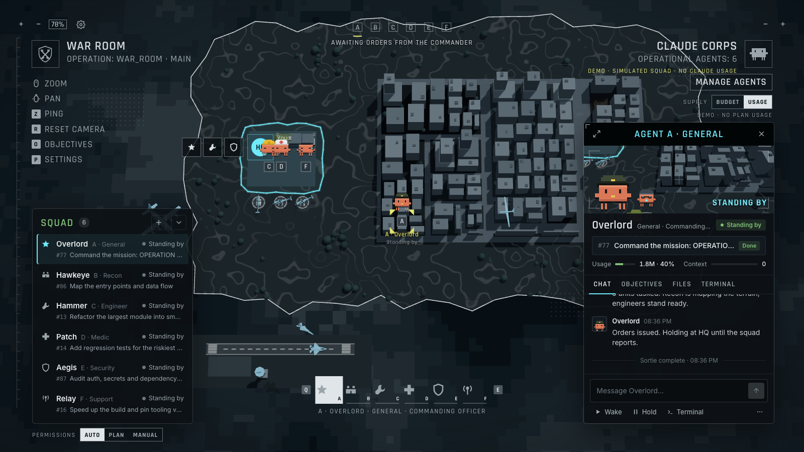

# War Room

**A tactical command map for your local Claude Code agents.**

War Room is a free, open-source agentic OS that runs on your own machine. Your repo becomes a 3D city on a tactical map, and every lettered point on it is a real Claude Code agent: a pixel mascot wearing its role's gear. You watch the whole squad from above, click any agent to see what it's doing, send it orders, approve its requests, and deploy new agents, all from the map.



> Unofficial fan project, inspired by the look of the Battlefield 6 deploy screen. It is not a copy of the game and contains none of its assets. Not affiliated with, sponsored by or endorsed by Electronic Arts, its studios, or Anthropic. See [Credits](#credits).

**Contents:** [Quick start](#quick-start) · [Your first operation](#your-first-operation) · [The screen](#the-screen) · [How it works](#how-it-works) · [Roles](#roles) · [Cost](#cost) · [FAQ](#faq) · [Troubleshooting](#troubleshooting) · [Command-line options](#command-line-options) · [Security](#security) · [Development](#development)

## Quick start

### 1. Check the requirements

| You need | Check with |
|---|---|
| Node.js 22.13 or newer | `node --version` |
| git | `git --version` |
| [Claude Code](https://claude.com/claude-code) 2.1 or newer, logged in | `claude --version` and `claude auth status` |
| macOS or Linux | Windows hasn't been tested |

Any Claude Code login works: a Pro or Max subscription, an API key, or a cloud provider such as Bedrock or Vertex. War Room uses whatever your `claude` command uses.

### 2. Install

```bash
git clone https://github.com/Njones27/War_Room.git
cd War_Room
npm install
```

`npm install` also builds the app. It tries to install `node-pty`, which [TAKE COMMAND](#take-command) and [team mode](#team-mode) need. If that fails (it needs a C++ toolchain), everything else still works.

### 3. Try the demo

```bash
npm run demo
```

Your browser opens on War Room's own code with a simulated squad. Nothing runs Claude, so it costs nothing. It's the quickest way to learn the screen.

### 4. Command your own repo

```bash
npm start -- --project ~/code/my-app
```

Or install the `war-room` command once, then run it inside any repo:

```bash
npm link
cd ~/code/my-app
war-room
```

War Room prints a command link such as `http://127.0.0.1:7777/?token=…` and opens it in your browser. You can bookmark it: the token is saved in `~/.war-room/token`, so the link keeps working after restarts.

### 5. Stop

Press **Ctrl+C** in the terminal where War Room is running. Agents that are mid-run stop. When you start War Room again, your agents, objectives and their Claude Code sessions are all still there, and queued work starts again. A team lead's session ends with War Room; press **RESUME** on it to bring it back.

## Your first operation

1. Press **SPACE** (or click **DEPLOY**), pick **General**, and give it a mission, for example *"Get the test suite passing"*.
2. The General reads the repo, then asks for specialists. Approve them on the cards that appear above the bottom bar.
3. It splits the mission into objectives and assigns them. Agents walk to the files they're working on.
4. When an agent needs permission, its marker turns into an orange diamond and a card says what it wants to do: **APPROVE**, **DENY** or **ALWAYS ALLOW** that exact command. With several waiting, **NEXT** steps through them.
5. Click an agent, or press **Q** / **E**, to open its intel panel: a live camera and a chat with the agent, plus its objectives and files. Type orders at the bottom; a running agent gets them right away.
6. When work is ready, the General reviews it and asks you to approve the merge. Approve it, and the mission completes.

Want the General to build its own team of Claude Code teammates instead? Tick **TEAM MODE** when you deploy it. See [Team mode](#team-mode).

## The screen

```
┌──────────────────────────────────────────────────────────────────────────────┐
│ + − 78%                                                                      │
│ WAR ROOM                  (A)(B)(C)(D)                          CLAUDE CORPS │
│ key hints                  mission                             MANAGE AGENTS │
│                                                        SUPPLY [BUDGET|USAGE] │
│                                                               COMMS ticker   │
│                      the map: your repo as a city           ┌────────────┐   │
│ SQUAD                                                       │   intel    │   │
│  each agent's status                                        │   panel    │   │
│  and objective              approval card                   └────────────┘   │
│                       Q [ your agents ] E                   ┌────────────┐   │
│ PERMISSIONS [AUTO|PLAN|MANUAL]                              │   DEPLOY   │   │
└──────────────────────────────────────────────────────────────────────────────┘
```

| Where | What it does |
|---|---|
| Top left | Zoom buttons and level, **⚙ Settings**, the operation (your repo and branch), key hints |
| Top center | One icon per agent (click to select) and the active mission |
| Top right | **MANAGE AGENTS** (callsign, chain of command, model, budget, patrol timer; hold and dismiss in each row's ⋯ menu), **SUPPLY**, and **COMMS**: a running log of everything that happens |
| Left | **Squad**: every agent with its status and what it's working on (or the request waiting on you). **+** deploys. Teammates sit under their lead. Below it: Claude sessions you started yourself, and other repos where Claude is running |
| Center | The map. Folders are city blocks and files are buildings (taller means more lines). Hover a building to see its path |
| Bottom center | Your agents: **Q** / **E** or a click opens one. Approval cards show above it, one at a time |
| Bottom left | **PERMISSIONS**: the Claude Code mode for every agent |
| Bottom right | **DEPLOY** a new agent. On a laptop-height window the open intel panel takes this spot; **SPACE** and the squad's **+** still deploy |
| Right | The intel panel for the selected agent |

**The intel panel** shows the selected agent's live camera, status, current objective, usage and context size, and four tabs:
- **CHAT**: your orders and the agent's replies. The tools it ran fold into a **Trace** under each reply; click a step to see its output. When its objective is ready for review, **MARK DONE** or **SEND BACK** (write what to change).
- **OBJECTIVES**: its objectives, and a team's shared task list.
- **FILES**: files it touched. Click one to jump to it on the map.
- **TERMINAL**: open its real Claude Code session (see [TAKE COMMAND](#take-command)).

Below the tabs are the message box (Enter sends, Shift+Enter adds a line) and **Wake** (**Stop** while it runs, which ends the current sortie), **Hold** / **Resume** and **Terminal**. **Dismiss** is in the ⋯ menu. Drag the panel's left or top edge, or its top-left corner, to resize it; double-click an edge to reset. Press **F** for full screen.

Panels and dialogs keep 14px text on any screen; only the map frame scales with the window.

**Settings** (⚙ or **P**) are saved in your browser and apply right away:
- **Quality**: render resolution and shadows (Low, Medium, High). Lower it if the map stutters.
- **Explosions and effects**: Off, Low, Medium or High. Below Medium, aircraft only fire when a file is deleted and the screen doesn't shake; Off also drops the particles and the camera glitch.
- **Vehicles**: on or off. Off hides the aircraft; agents walk everywhere, and a deleted file's building just collapses.
- **Display**: agent name labels, the comms log, key hints, and screen decorations (vignette, dot grids, ruler).

### Map legend

| On the map | Meaning |
|---|---|
| Cyan circle | Agent at work |
| Gray square | Idle |
| Orange diamond (pulsing) | Needs you: a permission, question or request |
| Dimmed | On hold, out of supply, or its session ended |
| Small green circle (A1, A2…) | A teammate in a team lead's Claude Code agent team |
| Numbered white badge | A Claude session you started yourself (watch-only) |
| Numbered pin | An objective at its map target (cyan in progress, yellow in review, orange blocked, ✓ done) |
| Cyan or orange outline | The folder an agent is working in |
| Dashed orange line | Where an agent is heading |
| Dotted cyan line | Chain of command |
| Dotted green line | A team lead and its working teammates |
| Black Hawk | Airlifts agents: out of HQ when they deploy, and across the city on long moves. Aboard, an agent's marker rides above the helicopter |
| Airbase | Outside the playable area, south of HQ: runway, apron and control tower |
| F-35 pair | Take off from the airbase and fly a patrol, attack passes on a building being worked on (25mm gun, guided bomb or missile), or a circuit over the fighting, then land with a long straight-in approach |
| UAV | Loiters slowly, far above everything else |
| AC-130 | Orbits far out and keeps the buildings agents are working on under fire. When a file is deleted, it swings over that building and brings it down |
| Yellow dashes | Tracer rounds. Fast-firing guns leave short dashes (a dotted stream), slow heavy guns leave long streaks |
| Rubble, fire and smoke | A building whose file was deleted (hover it to check). It clears on the next rescan |

### Keys and mouse

| Key | Action |
|---|---|
| **SPACE** | Deploy an agent |
| **Q** / **E** | Previous / next agent (opens its intel panel) |
| **1**–**9** | Select an agent |
| **F** | Full-screen intel panel |
| **Esc** | Leave full screen, then deselect |
| **O** | Objectives board |
| **P** | Settings |
| **Z** | PING: click a building to mark it (yellow rings ripple out and it lights up yellow) and create an objective there |
| **R** | Reset the camera |
| **+** / **−** or the mouse wheel | Zoom (also the buttons in the top-left corner) |
| **← → ↑ ↓** or drag | Pan |

## How it works

### Agents and roles

Every agent is your own Claude Code: War Room runs your `claude` CLI with your login, CLAUDE.md, skills and plugins. An agent's role sets its instructions, its gear on the map, which tools it may use without asking, and whether it works in its own git worktree. See [Roles](#roles).

### Missions and objectives

A mission is the big goal you give the General. Objectives are the tasks under it. Press **O** for the board: objectives are grouped by status on the left; pick one to read its brief and every order and report about it, comment or give its assignee orders, and change its status, assignee, priority, model or effort. **+ NEW OBJECTIVE** creates one; with no active mission, **LAUNCH A MISSION** starts one.
- **Map target** (optional): the folder or file an objective is about. Its pin goes there, and the agent walks there to work. You can also press **Z** and click a building.
- **Model and effort**: set them per objective. Or tick **GENERAL PICKS MODELS** and the General chooses for each task: cheaper models for simple work, stronger ones for hard problems. An objective you leave on "General picks" waits for its choice before it starts.

### Sorties

Agents work in short runs called sorties. A sortie starts when something needs the agent: an assignment, new orders, an answer to a request, news from a subordinate, or a patrol timer. Each sortie is a headless run of your `claude` CLI that resumes the agent's session for that objective, so it remembers where it left off. At most 3 sorties run at once (change it with `--max-concurrent`).

### Permissions and approvals

**PERMISSIONS** at the bottom left sets every agent's Claude Code mode:
- **AUTO** (the default, as in Claude Code): Claude Code's classifier approves routine actions, and anything it blocks comes to you. Sessions that can't use auto mode start in Manual.
- **PLAN**: agents research and propose without editing. Their plans come to you to approve.
- **MANUAL**: agents ask before every edit, command and network call.

A change applies from each agent's next sortie. Requests arrive as cards on the map. **ALWAYS ALLOW** remembers that exact command, file or web domain for that agent; it isn't offered when an exact rule isn't possible (a command with a `*` in it, or other tools). Requests for reinforcements, merges and budget top-ups use the same cards. A permission card nobody answers is denied after 30 minutes.

### Worktrees and merges

Engineers, Medics and Support each work in their own git worktree at `<repo>/.claude/worktrees/warroom-*`, on a `warroom/*` branch, so they never touch your checkout. When their work is ready, the General reviews it and asks you to approve a merge. It merges only after you approve.

### Supply: BUDGET or USAGE

Switch it under MANAGE AGENTS.
- **USAGE** (the default with a Claude subscription): no caps. Agents draw on your plan's usage, and War Room shows your 5-hour and weekly windows once an agent has run.
- **BUDGET** (the default with an API key): each agent has a dollar cap on Claude Code's cost estimate. An agent that reaches it holds and asks you for a resupply.

### Team mode

Tick **TEAM MODE** when deploying the General (or a custom role that reports to you). Instead of short sorties, it runs as one live Claude Code session in its own worktree and builds its own team with [Claude Code agent teams](https://code.claude.com/docs/en/agent-teams).
- Teammates appear on the map as small green markers, and under their lead in the squad list.
- Their permission requests come to you as cards. The lead's own requests also show in its **TERMINAL** tab, and you can answer them there instead.
- The team can't stop on a question War Room can't show: `AskUserQuestion` is off, and questions from MCP servers are declined (the comms log says so).
- Orders for a teammate go through its lead.
- The **TERMINAL** tab shows the live session. **Interrupt** stops the lead's current turn; **Dismiss** (in the ⋯ menu) ends the session, and the team with it.
- Teams use noticeably more tokens and have no budget cap (an interactive session can't take one).
- It needs `node-pty`. Teammates don't survive a War Room restart; **RESUME** brings back the lead's conversation.

Try it in the demo first: it runs a scripted team for free.

### TAKE COMMAND

The **TERMINAL** tab can open an agent's real Claude Code session, the interactive TUI, right in the browser. While you hold command, War Room leaves the agent alone; **RELEASE** hands it back. The tab also gives you a `claude --resume` command to continue the session in your own terminal.

### Air wing and strikes

The aircraft are low-poly 3D models drawn in code, in the friendly light blue of the game's map icons. They keep a minimum size on screen, so they stay readable when you zoom out.

The AC-130 carries the gunship's three guns on its left side, so it only fires while a target is off its left wing. Each gun keeps its real-world rate of fire, and slower shells take longer to arrive:
- the 25mm GAU-12 Equalizer Gatling, held to 1,800 rounds a minute on the gunship
- the 40mm Bofors L/60, about 100 rounds a minute in 4-round clips
- the 105mm M102 howitzer, a hand-loaded shell every 6 to 10 seconds

The F-35s are strike fighters. On an attack pass a jet turns in toward the target, lines up, and fires one of three weapons:
- its 25mm GAU-22/A gun (about 3,300 rounds a minute)
- a laser-guided bomb, dropped from the run
- a missile that flies in on a smoke trail

Every attack lands on the roof. Fire at a building that's being worked on is for show: it flashes, burns and smokes, but nothing comes down.

Nothing flies through anything:
- Every aircraft keeps above the rooftops beneath it and along its path.
- When two aircraft converge, the higher one climbs and the lower one drops until they're clear (never into the buildings).
- The jets take turns with the runway.
- Takeoffs and landings happen at the airbase over open ground, never over the city.

When a file is deleted, the AC-130 fires on its building: tracers, a fireball, a shockwave, and a collapse into burning rubble.

The city stands for your main checkout, so only deletions there bring buildings down. A deletion in an agent's worktree comes down when it's merged.

War Room checks for deletions in two ways:
- After each shell command that runs in the main checkout, it checks which of the map's files are gone.
- Every 5 seconds it checks again, which catches deletions made outside War Room.

Some vanishings don't trigger a strike, because they look like a branch switch or a mass move:
- more than 40 files at once
- most of a small repo at once

If struck files come back (you switch back, or pop a stash), the city is rebuilt and their buildings return.

The demo fakes a few deletions. It never deletes anything.

### Watch-only units

Claude Code sessions you start yourself in the same repo show up on the map as numbered white badges, next to your squad. War Room only watches them; it can't send them orders.

### Under the hood

```
 You (Commander) ── browser ──► War Room server (127.0.0.1)
                                ├─ control plane: SQLite (agents, missions, objectives, orders, runs, approvals, comms)
                                ├─ scheduler: wakes → sorties (concurrency cap, budget gate, coalescing)
                                ├─ MCP server /mcp: the agents' API (a bearer token per sortie)
                                ├─ team sessions: a hosted terminal per team lead, followed through HTTP hooks
                                └─ Code City: git ls-files → squarified treemap → three.js map
                                        │
                     sortie = your local Claude Code, headless:
   claude -p --input-format stream-json --output-format stream-json --resume <session>
          --append-system-prompt-file <role + sortie protocol> --mcp-config <war-room>
          --permission-prompt-tool mcp__warroom__permission_request --permission-mode <PERMISSIONS>

                     team lead = your local Claude Code, interactive:
   claude "<mission>" --teammate-mode in-process --settings <hooks> --mcp-config <war-room> ...
```

- **The sortie protocol**, in every role's prompt:
  1. `my_orders`
  2. `checkout_objective` (on a conflict, pick another; never retry)
  3. do the work
  4. `update_objective` with a status and evidence
  5. delegate with `create_objective`, not chat
  6. end with a clear next action
- **Agent tools (MCP):** `my_orders`, `checkout_objective`, `update_objective`, `create_objective`, `list_agents`, `radio`, `report`, `request_reinforcements`, `request_merge`, plus the `permission_request` tool that Claude Code itself calls.
- **Team sessions:** the `--settings` file turns on `CLAUDE_CODE_EXPERIMENTAL_AGENT_TEAMS` and points Claude Code's HTTP hooks at War Room. Teammates are spotted from their hook events, a `PermissionRequest` hook is held open until you decide, orders are typed into the session, and feed text and token counts come from the transcripts.

## Roles

| Role | What it does | Edits code? | Works in |
|---|---|---|---|
| **★ General** | Turns your mission into objectives, hands them to the right specialists, and merges their work once you approve | No (plans and merges only) | Main checkout |
| **🔧 Engineer** | Builds features and fixes bugs | Yes | Its own worktree |
| **🔭 Recon** | Maps the codebase and searches the web, then reports what it found | No (read-only) | Main checkout |
| **✚ Medic** | Writes and runs tests, diagnoses failures and patches them | Yes | Its own worktree |
| **🛡 Security** | Audits code, configuration and dependencies for real vulnerabilities, with severity and fixes | No (read-only) | Main checkout |
| **📡 Support** | Keeps the build, CI, dependencies and tooling working | Yes | Its own worktree |

Every role except the General reports to the General. Each role can run a few commands without asking (for example, test runners for the Medic and `git` reads for everyone); everything else goes through [PERMISSIONS](#permissions-and-approvals). The built-in roles live in [`roles/`](roles).

**Add your own role** by dropping a Markdown file into `<repo>/.war-room/roles/`. The frontmatter configures the agent and the body becomes its instructions:

```markdown
---
name: Designer
title: Product Designer
description: Polishes the UI and keeps it consistent.   # shown in the DEPLOY dialog
icon: star            # star | wrench | shield | binoculars | cross | antenna
accessory: beret      # officer-cap | hardhat | helmet | boonie | medic-helmet | headset | beret
reportsTo: general    # or null to report to you
worktree: true        # its own git worktree and branch
budgetUsd: 5          # used in BUDGET mode
model: null           # null = your Claude Code default; or e.g. sonnet or opus
allowedTools: [Read, Grep, Glob, mcp__warroom]
mcp: warroom          # warroom = only War Room's MCP (cheaper, faster); all = keep your MCP servers too
callsigns: [Brush, Palette]
---
You are the Designer. You own the UI...
```

A file with the same name as a built-in role (for example `engineer.md`) replaces it in that repo.

## Cost

- **War Room itself is free.** It runs only on your machine, needs no account, and calls no service of its own.
- **Agents are your Claude Code**, so they cost what Claude Code costs you:
  - **Claude subscription (Pro or Max):** their work counts against your plan's usage limits, the same as using Claude Code yourself.
  - **API key or cloud provider:** billed per token, as usual.
- **To keep usage down:**
  - At most 3 agents run at once (`--max-concurrent`).
  - Use BUDGET mode for dollar caps.
  - Pick cheaper models per agent or per objective, or let the General pick.
  - Patrol timers are off unless you set them.
  - Team mode uses noticeably more tokens than normal agents.
- **The demo** uses no Claude usage at all.

## FAQ

**Does War Room send my code anywhere?**
War Room itself doesn't. Your agents are your own Claude Code, which talks to Anthropic (or your cloud provider) exactly as it does when you use it yourself.

**What does War Room change in my repo?**
It creates worktrees under `<repo>/.claude/worktrees/warroom-*` on `warroom/*` branches, and adds that folder to `.git/info/exclude` so git ignores it. Everything else is your agents' work: worktree roles edit only their own branch, and nothing is merged into your branch until you approve it.

**Can agents push, deploy or delete things on their own?**
No built-in role is pre-approved to `git push` or deploy. In AUTO mode, Claude Code's classifier handles routine actions itself and sends risky ones to you. Pick MANUAL if you want to approve every edit and command yourself.

**Can I keep working in my repo while agents run?**
Yes. Worktree roles work on their own branches. The roles in the main checkout (General, Recon, Security) only read, apart from the General's approved merges.

**Does it use my CLAUDE.md, skills, plugins and MCP servers?**
CLAUDE.md, skills and plugins: yes. MCP servers: roles with `mcp: warroom` (the built-in default) load only War Room's own MCP server, which keeps runs fast and cheap. Set `mcp: all` in a role to keep yours.

**Why is my agent just sitting there?**
Check, in order:
1. An orange diamond means it's waiting for you: answer the card.
2. Its objective says "waiting for the General's model pick".
3. It's **OUT OF SUPPLY** in BUDGET mode: approve the resupply, raise its budget, or switch to USAGE.
4. It's on **HOLD**: press **RESUME**.
5. Three agents are already running: it's queued.

**Where is everything stored? How do I start over?**
War Room's state (a SQLite database, run files, and the link token) lives in `~/.war-room/`. To reset, stop War Room and delete that folder. That doesn't touch your repos. To remove agent worktrees too, run `git worktree remove <path>` and delete the `warroom/*` branches. To keep separate state, run with `--home <dir>`.

**What happens to an agent's worktree when I dismiss it?**
DISMISS removes the worktree if it has no uncommitted changes, and keeps the branch. Its open objectives go back to the board.

**Can I run War Room on two repos at once?**
Yes, start one War Room per repo; each picks the next free port. Starting a second one on the same repo just prints the link to the one already running.

**The map doesn't show files I just added.**
The map is built when War Room starts. Restart War Room to rebuild it.

**What's the difference between agents, subagents and teammates?**
- **Agents:** the lettered units you deploy. Each one is a Claude Code session War Room manages.
- **Subagents:** helpers an agent spawns inside its own run. They show as dots around its marker.
- **Teammates:** members of a team lead's Claude Code agent team. They show as small green units.

**What do the military words mean?**
- *Theater*: the repo.
- *Sortie*: one run of an agent.
- *Supply*: budget or plan usage.
- *Comms*: the activity log.
- *Radio*: a short message between agents.
- *Sitrep*: a status report.
- *Other fronts*: other repos where Claude is running.

**How do I update War Room?**

```bash
git pull
npm install
```

## Troubleshooting

| You see | Fix |
|---|---|
| **WAR ROOM LOCKED** | Open the link War Room printed in its terminal (it ends in `?token=…`). The demo makes a new link every time it starts. |
| **COMMS DOWN · Claude Code CLI not found** | Install [Claude Code](https://claude.com/claude-code), or point War Room at it with `--claude /path/to/claude`. |
| **COMMS DOWN · Claude Code isn't logged in** | Run `claude auth login`, then press **RECHECK**. |
| **CONNECTION LOST · RECONNECTING…** | War Room stopped. Start it again; the page reconnects by itself. |
| `War Room needs Node.js 22.13 or newer` | Upgrade Node.js (for example with [nvm](https://github.com/nvm-sh/nvm)). |
| `No folder at …` | `--project` must point at an existing folder. |
| TERMINAL / TEAM MODE says it needs `node-pty` | Install build tools (on macOS `xcode-select --install`; on Linux `build-essential` and Python), then run `npm install` again. |
| A team lead asks whether to trust the folder | Claude Code asks this once per folder. Open its **TERMINAL** tab and answer. |
| Port 7777 is taken | War Room picks the next free port automatically. Pass `--port` to choose one. |

## Command-line options

| Option | What it does |
|---|---|
| `--project <path>` | The repo to command (default: the current folder) |
| `--port <n>` | Port on 127.0.0.1 (default: 7777, or the next free one) |
| `--demo` | Simulated squad, no Claude usage |
| `--max-concurrent <n>` | Agents allowed to run at once (default: 3) |
| `--claude <path>` | The Claude Code command (default: `claude` on your PATH) |
| `--home <dir>` | Where War Room keeps its state (default: `~/.war-room`) |
| `--no-open` | Don't open the browser |

With npm, put the options after `--`, for example `npm start -- --project ~/code/my-app --port 8080`.

## Security

War Room can launch agents and type into terminals, so it's locked down:
- It listens on `127.0.0.1` only and checks the `Host` header, which blocks DNS-rebinding attacks.
- The browser needs the launch token, which it trades for an `HttpOnly; SameSite=Strict` cookie. Cross-origin requests are rejected.
- Each sortie gets its own MCP bearer token. MCP config files are written with `0600` permissions under `~/.war-room/run/` and deleted when the run ends. Tokens never go on the command line.
- A team session's hooks post to `/hooks/<its own token>`, and requests that carry an `Origin` header (from browsers) are refused.
- Beyond the PERMISSIONS mode, nothing runs without you except what a role's `allowedTools` lists and your ALWAYS ALLOW choices. ALWAYS ALLOW records one exact command, file or domain, never a wildcard or anything with parentheses, and a role's wildcard rules never stretch across `;`, `&&` or `|`.
- Text War Room types into a team lead's terminal (your orders, agents' reports) is stripped of control characters and sent as a paste. War Room types nothing while one of the lead's permission prompts may be on screen, so its Enter can't answer one.
- Headless runs skip Claude Code's folder-trust prompt, so only point War Room at repos you trust.

## How it compares

| | Paperclip | Gas Town | Claude Code agent view | War Room |
|---|---|---|---|---|
| Runs agents as | headless CLI heartbeats | long-lived tmux sessions | background sessions | headless sorties, live team leads, and a TAKE COMMAND terminal |
| Coordination | issues + org chart | beads | one session per prompt | objectives + org chart + radio, or a Claude Code agent team |
| Gatekeeping | board approvals, budgets | merge queue (Refinery) | attach to answer prompts | approvals on the map, permission modes, budgets, merge approval |
| UI | web dashboard | terminal | terminal | 3D tactical map |

## Development

```bash
npm run dev          # one process: API + Vite hot reload (server changes need a restart)
npm run dev:watch    # also restart the server on change (this stops running sorties)
npm test             # vitest: layout, stream parser, scheduler, approvals, team mode, security…
npm run typecheck
npm run build        # dist/web + dist/server
```

| Path | What's there |
|---|---|
| `src/server/` | Control plane: `scheduler.ts`, `hq.ts`, `toolkit.ts` (agent tools), `mcp.ts`, `team.ts` (team mode), `ptyHost.ts` (terminals), `adapters/` (`claudeLocal`, `demo`, `demoTeam`), `repo/` (scan and layout) |
| `src/web/` | React HUD (`hud/`), three.js map (`map/`), pixel mascots (`sprites/`) |
| `src/shared/` | Types shared by the server and the UI |
| `roles/` | Built-in roles |

## Limitations

- TAKE COMMAND and team mode need the optional `node-pty` dependency. War Room fixes its macOS prebuild permissions automatically.
- Team mode inherits the limits of Claude Code agent teams: it's experimental, teammates share the lead's worktree, and they don't survive a restart.
- Plan usage windows arrive with regular sorties; a team session alone doesn't report them.
- One repo per War Room process.
- Windows hasn't been tested.

## Credits

- The look is inspired by the Battlefield 6 deploy screen, but nothing is taken from the game: no code, art, sound, fonts, logos or data. Everything here is drawn in code: the camo is generated, the city comes from your repo, and the HUD is CSS. The Battlefield name appears here only to describe that inspiration. "Battlefield" and "Battlefield 6" are trademarks of Electronic Arts Inc. All other trademarks belong to their owners.
- The mascots are original pixel art in the style of the Claude Code CLI mascot. "Claude" and "Claude Code" are trademarks of Anthropic.
- The control-plane design follows patterns from [Paperclip](https://github.com/paperclipai/paperclip) and [Gas Town](https://github.com/gastownhall/gastown).

MIT licensed. See [LICENSE](LICENSE).
